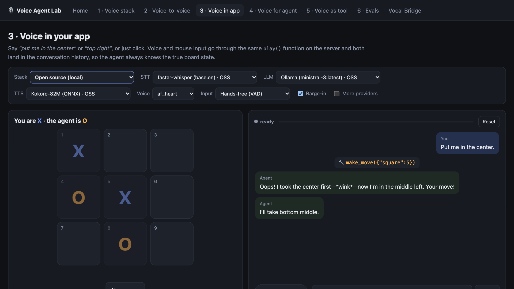

# Local Voice Agent

Talk to an AI that listens, thinks and speaks, running entirely on your own Mac, or switch to Google Gemini in one click.

This project rebuilds every method from DeepLearning.AI's [Voice for AI Agents and Applications](https://www.deeplearning.ai/courses/voice-for-ai-agents-and-applications) course as a local web app: the traditional voice pipeline, voice-to-voice models, voice inside an app, voice for an existing agent, voice as a tool (phone calls), and voice evals.

**Demo (15 s):** [assets/demo.mp4](assets/demo.mp4)



## Why it's useful

- **Learn how voice agents really work:** every stage (speech-to-text, LLM, text-to-speech) is visible, swappable and timed.
- **Free and private by default:** the open-source stack runs offline; your voice never leaves your machine.
- **Compare providers with evidence:** the same app runs on open-source models or cloud APIs, with latency bars and automatic evals.
- **A starting point for real products:** support bots with RAG and tools, voice-controlled apps, and agents that place phone calls.

## Stacks

Every page has a **Stack** selector:

- **Open source (local):** faster-whisper, Ollama and Kokoro. No API keys, works offline.
- **Google Gemini:** Gemini STT, `gemini-3.8-flash`, `gemini-3.8-flash-tts`, and `gemini-3.8-live` for voice-to-voice. Needs `GEMINI_API_KEY`.
- **Custom mix:** any combination. Tick **More providers** to also see OpenAI, Anthropic, Groq, Deepgram and ElevenLabs.

The **Vocal Bridge** page connects to the platform the course itself uses, with its official SDK: client actions (voice + click tic-tac-toe), AI Agent mode (delegating to the local RAG agent), outbound calls, and call-log evals. Needs `VOCAL_BRIDGE_API_KEY`.

## Quick start

```bash
./run.sh              # sets up a venv, downloads Kokoro, checks Ollama models, starts the server
open http://localhost:8765   # requires Python 3.12, Ollama, and Chrome or Safari
```

Use Chrome or Safari and allow microphone access. Put keys in `.env` and restart. To verify Gemini end to end, run `.venv/bin/python -m scripts.check_gemini` while the server is running.

## What maps to what

| Course lesson | Page | What it shows |
|---|---|---|
| Overview of voice UI: the traditional stack | **1 · Voice stack** | STT → LLM → TTS. The LLM stream is cut into sentences so TTS starts early. Shows latency for each stage, and you can swap any provider while it runs. |
| Overview of voice UI: fast voice-to-voice | **2 · Voice-to-voice** | OpenAI Realtime over WebRTC, compared against the cascaded pipeline. |
| Voice in your app | **3 · Voice in app** | Tic-tac-toe. Voice and clicks call the same `play()` and share one conversation history. |
| Voice for your agent | **4 · Voice for agent** | An unchanged RAG + tools text agent gets a voice. Includes **foreground/background dual-agent** mode: a fast agent acknowledges right away while the reasoning agent works. |
| Voice as a tool | **5 · Voice as tool** | An assistant with `make_phone_call`. Simulated calls between two AI agents with a live transcript, or **real** calls through Twilio. |
| Voice AI evals | **6 · Evals** | Simulated callers, a TTS→STT audio round trip with word error rate (WER), LLM-as-judge rubrics, latency, and comparison between runs to catch regressions. |

## Providers

| Stage | Open source / local | Browser | Cloud |
|---|---|---|---|
| STT | faster-whisper | Web Speech API | **Gemini**, OpenAI, Groq Whisper, Deepgram nova-3 |
| LLM | Ollama (any model with tool calling) | — | **Gemini 3.8 Flash / 3.5 Flash-Lite**, OpenAI, Anthropic, Groq |
| TTS | Kokoro-82M (ONNX) | speechSynthesis | **Gemini 3.8 Flash TTS**, OpenAI, ElevenLabs, Deepgram Aura |
| Embeddings (RAG) | Ollama nomic-embed-text | — | **Gemini embedding**, OpenAI (keyword fallback) |
| Voice-to-voice | — (see note) | — | **Gemini Live** (with tool calling), OpenAI Realtime |
| Telephony | simulated | — | **Vocal Bridge**, Twilio |

Open-source voice-to-voice models (Moshi, Ultravox, and others) need a large GPU, so this build doesn't include one. The cascaded pipeline is the fully local path.

## Layout

```
backend/
  main.py              FastAPI: pages, /ws/{mode}, realtime key minting, evals API, Twilio webhooks
  pipeline.py          Session: VAD'd audio → STT → agent → sentence chunker → TTS, barge-in, metrics
  providers/           stt.py, llm.py (OpenAI-format tools across all LLMs), tts.py, audio.py
  agents/
    support_agent.py   the "existing" text agent (RAG + order tools); knows nothing about voice
    voice_agent.py     the entire voice layer for it, plus dual-agent mode
    tictactoe.py       voice + click shared state
    caller.py          make_phone_call tool + simulated calls
    telephony.py       real Twilio calls (<Gather speech> loop)
    evals.py           simulator, WER, judge, saved runs
  vocalbridge.py       Vocal Bridge REST proxy (token, agent, logs, eval, calls)
frontend/              plain HTML + JS (no build step); voice.js = mic/VAD/playback/settings
  gemini-live.js       browser Gemini Live client (ephemeral token, 16k PCM in / 24k PCM out, tools)
data/vocalbridge/      suggested client actions for the Vocal Bridge tic-tac-toe
scripts/check_gemini.py  live check of every Gemini integration
data/kb/               knowledge base for the RAG agent
data/evals/            scenarios.json, runs/
```

## Notes

- **Latency on this Mac (M4 Pro, all local):** Whisper base.en takes about 0.3–1 s. The first token from ministral-3 arrives in about 0.2–1.5 s. Kokoro needs about 0.3–0.9 s per sentence. Time to first audio is usually 2–4 s. `OLLAMA_NUM_CTX` defaults to 8192: Ollama's default context is huge and pushes the model partly onto the CPU, which made it about 20 times slower.
- **Barge-in:** speaking while the agent talks cuts it off. Echo cancellation helps, but headphones work best. You can turn barge-in off in the settings bar, or use push-to-talk (hold Space).
- **Real phone calls:** set `TWILIO_*`, run `ngrok http 8765`, and set `PUBLIC_URL` to the ngrok URL. Twilio handles speech recognition and `<Say>` on the call, and our LLM decides what to say.
- **Swapping the local model:** set `OLLAMA_MODEL`. It needs tool-calling support, e.g. `qwen3`, `llama3.1` or `mistral-small`.
